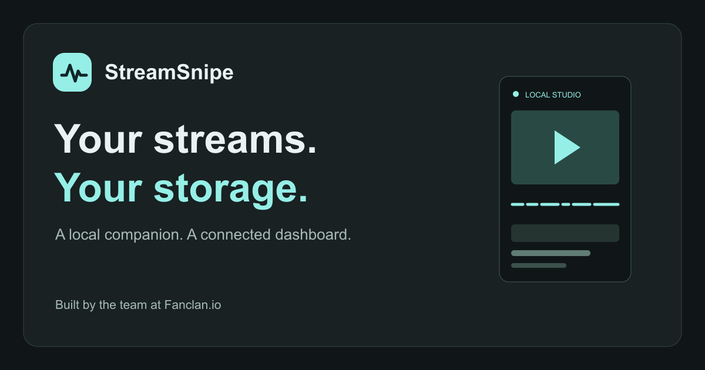

# StreamSnipe Portal

**The local-first stream recording dashboard and website — by the team at [Fanclan.io](https://fanclan.io).**

StreamSnipe gives you a modern web interface for a recorder running on your own hardware. This repository contains the public website, documentation, and the single shared dashboard used by the hosted portal, desktop companion, and Docker app.

Maintained by [zerodayprime](https://github.com/zerodayprime) under [Fanclan](https://github.com/Fanclan). The recording engine and distributions live in [StreamSnipe Companion](https://github.com/Fanclan/StreamSnipe-Companion).

## Architecture

- Static public pages built with Astro.
- A React dashboard with hosted and bundled build targets.
- Direct authenticated access to the companion on the user's computer.
- Versioned API compatibility and an immutable local-dashboard release artifact.
- Automatic Vercel deployment from the protected production branch.

There is no recording backend on Vercel. The portal does not upload, proxy, transcode, or store recordings, thumbnails, or previews. Optional S3 backups are performed by the companion directly to a user's own account.

## Product experience

The dark recording-studio interface includes a full light theme, onboarding and pairing, channel management, recording controls, a searchable media library, local playback, storage settings, and clear disconnected/error states. The bundled dashboard provides a fallback when a browser cannot connect to the local companion.

Chrome and Edge are the initial supported browsers for the hosted bridge. Desktop recording requires a running companion on the same computer; Docker users access their own instance's dashboard.

## Development

Install dependencies with the committed lockfile, then run the development server. Build the public site and the separate `build:dashboard` target before release. The latter produces the dashboard artifact consumed by the companion repository.

Tests use synthetic fixtures and a local companion. Do not introduce third-party scripts or analytics into the application dashboard, publish user media in screenshots, or include credentials in URLs. Use generated examples for public documentation.

## Deployment and releases

The Fanclan Vercel project serves the static portal. Production deployments must pass the required checks for their exact commit. Preview deployments are excluded from indexing and are not automatically trusted by paired companions.

Download links must refer to verified published companion assets. The portal and companion have independent versions with an explicit protocol compatibility range. Dashboard bundles are immutable and checksummed.

## Contributing and attribution

See [CONTRIBUTING.md](CONTRIBUTING.md) and [SECURITY.md](SECURITY.md). StreamSnipe is built by the team at [Fanclan.io](https://fanclan.io), maintained by [zerodayprime](https://github.com/zerodayprime), and distributed under the [MIT license](LICENSE), retaining the original notice.
